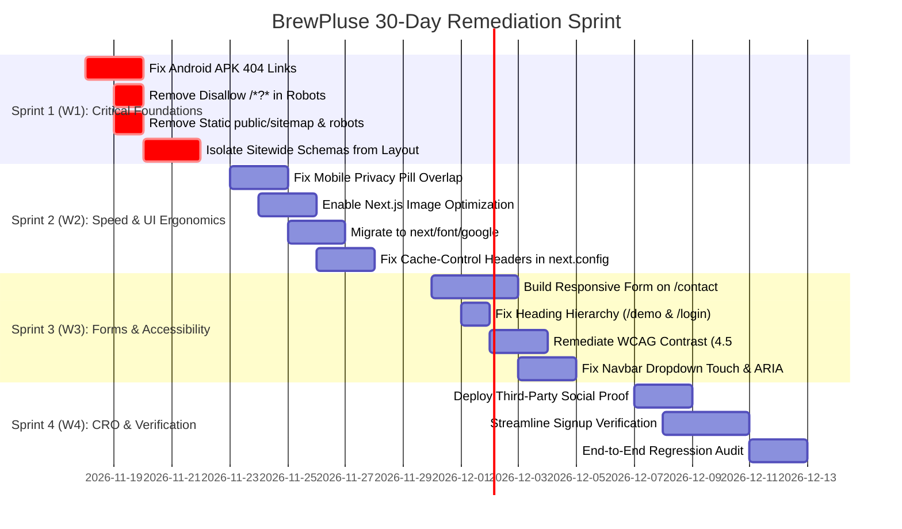

# 🗓️ 30-Day Technical Remediation & Growth Action Plan: Brewpluse.com

**Property:** [https://brewpluse.com/](https://brewpluse.com/)  
**Document Purpose:** Operational, step-by-step engineering and strategic execution guide for developers, designers, and marketing stakeholders.  
**Execution Cycle:** 4 Sprints across 30 Days (Weeks 1 to 4)  
**Verification Standard:** Every task includes explicit files, line numbers, expected outcome, and verification command.

---

## 📅 High-Level Timeline & Resource Allocation



---

## 🚀 Sprint 1 (Week 1): Critical Technical, Asset & SEO Fixes

### Task 1.1: Restore Broken Android APK Download Assets (Priority: P0 - CRITICAL)
- **Objective:** Fix the HTTP 404 errors on `/download` for `/BrewPluse-Android.apk` and `/downloads/BrewPluse-Android.apk`.
- **Files Affected:**
  - `src/app/download/page.tsx` (Lines 24–27, 136)
  - `public/` (Target destination for binary asset)
- **Action Steps:**
  1. Build or export the production Android APK from `android/` (`gradlew assembleRelease` or copy the signed debug package).
  2. Place the production binary at `public/downloads/BrewPluse-Android.apk`.
  3. Ensure a symlink or route rewrite serves `/BrewPluse-Android.apk` seamlessly to prevent legacy 404s.
- **Verification:** Execute `curl -I https://brewpluse.com/downloads/BrewPluse-Android.apk` and ensure `HTTP 200 OK` with `Content-Type: application/vnd.android.package-archive`.

---

### Task 1.2: Remove Destructive `Disallow: /*?*` Wildcard from Robots.txt (Priority: P1)
- **Objective:** Unblock search engine crawlers from reading UTM tracking URLs, shared links, and Next.js RSC queries.
- **Files Affected:**
  - `public/robots.txt`
  - `src/app/robots.ts` (Lines 11, 23, 39)
- **Action Steps:**
  1. Remove `disallow: ['/dashboard/', '/api/', '/setup/', '/*?*']`.
  2. Replace with explicit parameter protection:
     ```typescript
     disallow: ['/dashboard/', '/api/', '/setup/', '/*?_rsc=*']
     ```
- **Verification:** Test the URL `https://brewpluse.com/?utm_source=google` in Google Search Console's Robots.txt Tester and ensure status is **ALLOWED**.

---

### Task 1.3: Eliminate Static Sitemap and Robots File Collision (Priority: P1)
- **Objective:** Prevent static files in `public/` from overriding dynamic Next.js App Router handlers.
- **Files Affected:**
  - Delete `public/sitemap.xml`
  - Delete `public/robots.txt`
  - Maintain `src/app/sitemap.ts` and `src/app/robots.ts`
- **Action Steps:**
  1. Remove the static files so Next.js handles route requests via dynamic compilation.
  2. In `src/app/sitemap.ts`, replace `new Date().toISOString()` with fixed release timestamps or dynamic database/git dates.
- **Verification:** Fetch `https://brewpluse.com/sitemap.xml` and verify HTTP headers indicate dynamic Next.js generation.

---

### Task 1.4: Isolate Sitewide Schema Injection from Root Layout (Priority: P1)
- **Objective:** Eliminate Google structured data spam penalties caused by injecting `FAQPage`, `LocalBusiness`, and `SoftwareApplication` on legal and transactional pages.
- **Files Affected:**
  - `src/app/layout.tsx` (Lines 110–340)
  - `src/app/page.tsx`
  - `src/app/cafe-pos/page.tsx`
  - `src/app/pricing/page.tsx`
- **Action Steps:**
  1. Retain **only** `Organization` and `WebSite` in `src/app/layout.tsx`.
  2. Move `SoftwareApplication` directly into `src/app/cafe-pos/page.tsx` and `src/app/pricing/page.tsx`.
  3. Move `FAQPage` exclusively to pages that feature visible FAQ accordion UI components.
- **Verification:** Test `/privacy` and `/terms` using Google Rich Results Test tool; verify zero invalid `FAQPage` or `SoftwareApplication` errors.

---

## 🎨 Sprint 2 (Week 2): UI/UX, Speed & Responsive Ergonomics

### Task 2.1: Relocate Mobile Floating "Privacy Choices" Button (Priority: P1)
- **Objective:** Stop the floating badge from covering trust bullet points on 360px–390px mobile viewports.
- **Files Affected:**
  - `src/components/PrivacyChoices.tsx`
  - `src/components/MobileBottomNav.tsx`
- **Action Steps:**
  1. Apply Tailwind responsive class: `className="hidden lg:flex fixed bottom-5 left-5 z-40 ..."`
  2. Add an explicit "Privacy & Cookies" link inside the mobile slide-out drawer menu (`MobileBottomNav.tsx`).
- **Verification:** Emulate mobile viewport at 360px x 740px in DevTools; verify that `✓ ₹0/month software subscription` is 100% visible and unobstructed.

---

### Task 2.2: Re-Enable Next.js Image Optimization & Convert Hero PNG (Priority: P1)
- **Objective:** Reduce hero image payload from 419.7 KB to ~45 KB, cutting mobile LCP by ~600ms.
- **Files Affected:**
  - `next.config.js` (Line 7–9)
  - `src/components/HeroPosMockup.tsx`
  - `public/brewpluse-storefront.png`
- **Action Steps:**
  1. Remove `images: { unoptimized: true }` from `next.config.js`.
  2. Convert `brewpluse-storefront.png` to lossless WebP format.
  3. Serve via `<Image priority width={1200} height={630} ... />`.
- **Verification:** Run Lighthouse Performance audit; verify LCP image download time drops below 300ms.

---

### Task 2.3: Migrate to Native Next.js Font Optimization (`next/font/google`) (Priority: P2)
- **Objective:** Eliminate 3 render-blocking external Google Fonts requests.
- **Files Affected:**
  - `src/app/layout.tsx` (Remove external `<link>` tags)
- **Action Steps:**
  1. Import `Plus_Jakarta_Sans`, `Inter`, and `JetBrains_Mono` from `next/font/google`.
  2. Apply CSS variables to root `<html>` tag: `<html className={`${jakarta.variable} ${inter.variable} ${mono.variable}`}>`.
- **Verification:** Inspect network waterfall; confirm zero outgoing requests to `fonts.googleapis.com` or `fonts.gstatic.com`.

---

### Task 2.4: Rectify Aggressive Anti-Caching Headers (Priority: P2)
- **Objective:** Allow browsers and CDN edges to cache static marketing pages while keeping authenticated dashboards real-time.
- **Files Affected:**
  - `next.config.js` (Lines 20–36)
- **Action Steps:**
  1. Scope `no-store, no-cache` strictly to `/(dashboard|api|setup)/:path*`.
  2. Apply `public, max-age=3600, s-maxage=86400, stale-while-revalidate=604800` to all marketing pages.
- **Verification:** Execute `curl -I https://brewpluse.com/features` and verify `Cache-Control` header returns `public, max-age=3600...`.

---

## 📝 Sprint 3 (Week 3): Forms, Accessibility & Content Depth

### Task 3.1: Build Interactive Commercial Inquiry Form on `/contact` (Priority: P1)
- **Objective:** Eliminate lead drop-off for enterprise, franchise, and desktop visitors.
- **Files Affected:**
  - `src/app/contact/page.tsx`
- **Action Steps:**
  1. Construct a clean 4-field inquiry component:
     - Name & Email (Required)
     - Cafe / Restaurant Name & City (Required)
     - Number of Outlets (Single / 2-5 / 5+)
     - Message / Requirements
  2. Wire up to a secure API endpoint (`/api/contact/submit`) with honeypot spam protection and instant email notification.
- **Verification:** Submit a test message on `/contact`; confirm form validation, loading spinner, and success toast.

---

### Task 3.2: Rectify Heading Hierarchies on `/demo` and `/login` (Priority: P2)
- **Objective:** Ensure valid semantic heading structure across all indexed pages.
- **Files Affected:**
  - `src/app/demo/page.tsx` (Demote secondary `<h1>` to `<h2>`)
  - `src/app/login/page.tsx` (Add semantic `<h1>Merchant & Staff Login</h1>`)
- **Verification:** Run Lighthouse SEO audit; verify zero heading hierarchy warnings.

---

### Task 3.3: Remediate WCAG 2.2 AA Color Contrast Deficits (Priority: P2)
- **Objective:** Fix 31 low-contrast elements flagged by Lighthouse.
- **Files Affected:**
  - `src/app/page.tsx`
  - `src/components/TrustBar.tsx`
  - `src/components/Footer.tsx`
- **Action Steps:**
  1. Replace low-contrast gray `#8a857f` with `#635e58` (achieving 4.6:1 contrast ratio against white).
  2. Replace `#9ca3af` Quick Links text with `#4b5563` (5.2:1 contrast ratio).
- **Verification:** Run Lighthouse Accessibility audit; verify contrast score reaches **100/100**.

---

### Task 3.4: Make Header Dropdown Menus Touch & Keyboard Accessible (Priority: P2)
- **Objective:** Enable tablet, touch-laptop, and keyboard users to access `Modules`, `Solutions`, and `Resources`.
- **Files Affected:**
  - `src/components/Navbar.tsx`
- **Action Steps:**
  1. Add `onClick={() => setModulesOpen((prev) => !prev)}` to dropdown trigger buttons.
  2. Add `aria-expanded={modulesOpen}` and `aria-haspopup="true"`.
  3. Support `Enter` and `Escape` keyboard shortcuts.
- **Verification:** Navigate header exclusively using the `Tab` key; verify dropdowns open and close smoothly.

---

## 🎯 Sprint 4 (Week 4): Conversion Rate Optimization (CRO) & Verification

### Task 4.1: Integrate Verifiable Third-Party Social Proof Badges (Priority: P1)
- **Objective:** Transform self-hosted review claims into undeniable trust anchors.
- **Files Affected:**
  - `src/components/Testimonials.tsx`
  - `src/app/page.tsx`
- **Action Steps:**
  1. Embed verified review widgets from Google Maps, Capterra, or Trustpilot.
  2. Add real cafe customer photos, location badges (`Indiranagar, Bangalore`, `Bandra West, Mumbai`), and verified quote attribution.
- **Verification:** Verify all customer testimonials feature clickable external references or authentic video snippets.

---

### Task 4.2: Streamline Signup Conversion Funnel (Priority: P2)
- **Objective:** Reduce the ~35–45% drop-off caused by immediate mandatory email OTP verification.
- **Files Affected:**
  - `src/app/signup/page.tsx`
- **Action Steps:**
  1. Implement frictionless instant onboarding: allow merchants to enter email/password and immediately land in their provisioned demo store.
  2. Defer mandatory OTP verification until the merchant punches their first live transaction or connects a bank account.
- **Verification:** Measure signup completion velocity in Google Analytics funnel visualization.

---

### Task 4.3: Full End-to-End Regression Audit & Milestone Sign-Off (Priority: P1)
- **Objective:** Final quality assurance review across SEO, Performance, Security, and UX.
- **Execution Checklist:**
  - [ ] Google Search Console: Clean robots.txt, 0 blocked URLs, valid sitemap.
  - [ ] Google Rich Results: 100% valid Organization & SoftwareApplication schemas.
  - [ ] Lighthouse Scores: Performance > 90, Accessibility > 98, Best Practices > 95, SEO > 100.
  - [ ] All APK and hardware download links return HTTP 200 OK.
  - [ ] Mobile responsive layout verified across 360px, 390px, 768px, and 1440px.
