# 🛠️ Master Technical Implementation & Engineering Roadmap: BrewPluse Website Transformation

**Document Version:** 1.0.0  
**Target Property:** [BrewPluse.com](https://brewpluse.com/)  
**Date:** November 17, 2026  
**Engineering Leads:** Senior Full-Stack Lead, UI/UX Principal, Backend Systems Architect, Technical SEO Lead  
**Execution Governance:** Staged rollout with strict zero-regression guarantees. All changes must preserve existing authentication, database models, payment webhooks, and live demo routes.

---

## 1. Technical Scope & Architecture Principles

### 1.1 Non-Negotiable Engineering Rules
1. **Preserve Working Infrastructure:** Do not modify working authentication (`firebaseAuth.ts`), order state machine (`orderStateMachine.ts`), Web Bluetooth printer drivers (`thermalPrinter.ts`), or MongoDB connection pools (`mongodb.ts`).
2. **Zero Fake Features:** Do not market capabilities that are unverified. Implement genuine pages, real UI states, and functional forms.
3. **No Downtime / Non-Destructive Migrations:** All new database fields must have safe defaults. Public marketing pages must be statically pre-rendered (SSG/ISR) for optimal TTFB and LCP.
4. **Cleanroom Original Assets:** Zero copying of CafeFlow styles or proprietary artwork. Use bespoke SVG graphics, Lucide icons, and Tailwind color tokens from `Brewpluse_New_Design_System.md`.

---

## 2. Page-by-Page Implementation Blueprint

```mermaid
graph TD
    A["BrewPluse Implementation Plan"] --> B["Phase 1: Architecture & SEO Fixes"]
    A --> C["Phase 2: New High-Value Pages"]
    A --> D["Phase 3: Core Page Redesign & Ergonomics"]
    A --> E["Phase 4: Responsive & QA Verification"]

    B --> B1["Remove Global Schema Pollution in layout.tsx"]
    B --> B2["Fix robots.txt and sitemap.ts Shadowing"]
    B --> B3["Enable Image Optimization & Edge Cache in next.config.js"]

    C --> C1["Build /compare Head-to-Head Hub"]
    C --> C2["Build /documentation Setup & Manual Portal"]
    C --> C3["Build /faq Categorized Hub"]
    C --> C4["Add Interactive Form to /contact"]

    D --> D1["Redesign Homepage Sections & Elevate Live Demo"]
    D --> D2["Upgrade /pricing with Dynamic ROI Slider"]
    D --> D3["Fix Broken APK & PWA Install on /download"]
    D --> D4["Eliminate Mobile Floating UI Collision"]

    E --> E1["Cross-Browser Testing (360px to 1440px)"]
    E --> E2["Lighthouse & Core Web Vitals Audit"]
    E --> E3["End-to-End Route Validation"]
```

---

## 3. Detailed Work Breakdown Structure (WBS)

### Sprint 1: Technical SEO, Caching & Global Infrastructure
- **Task 1.1 — Clean Schema Markup in `src/app/layout.tsx`:**
  - Remove global `FAQPage`, `LocalBusiness`, and `ItemList` JSON-LD schemas from root layout.
  - Retain only clean sitewide `Organization` and `WebSite` schemas with site navigation.
  - Implement page-specific schemas on `/`, `/pricing`, `/faq`, `/compare`, and blog routes.
- **Task 1.2 — Resolve Robots.txt & Dynamic Sitemap Shadowing:**
  - Delete conflicting static `public/robots.txt` and `public/sitemap.xml` that block dynamic metadata generation.
  - Update `src/app/robots.ts` to allow standard crawler indexing while protecting `/dashboard/`, `/api/admin/`, and `/kitchen/`.
  - Update `src/app/sitemap.ts` to dynamically include all new product, solution, and comparison routes with proper priority scores and change frequencies.
- **Task 1.3 — Optimize Next.js Performance in `next.config.js`:**
  - Remove `images: { unoptimized: true }` to enable automatic WebP/AVIF compression.
  - Configure edge caching headers (`Cache-Control: public, max-age=3600, stale-while-revalidate=86400`) for static public routes, replacing blanket `no-cache, no-store`.

### Sprint 2: Core Page Redesign & Conversion Optimization
- **Task 2.1 — Homepage Modernization (`src/app/page.tsx` & Components):**
  - Implement original hero section with dual CTAs ("Launch Your Cafe Free" + "Explore Live Interactive Demo").
  - Feature the interactive live sandbox prominently above the fold.
  - Refactor feature showcase with the 3 operational pillars (Counter POS, QR Ordering, Kitchen KDS).
  - Add transparent pricing summary and comparison teaser.
  - Relocate the mobile "Privacy Choices" pill button to prevent collision with hero copy on viewports <390px.
- **Task 2.2 — Upgrade Pricing Hub (`src/app/pricing/page.tsx` & `PricingCalculator.tsx`):**
  - Implement an interactive daily order volume slider (10 to 1,000 orders/day).
  - Add payer toggle ("Cafe Absorbs ₹1" vs. "Diner Convenience Fee").
  - Display live calculated annual savings vs. legacy software retainers.
- **Task 2.3 — Fix Hardware Download Hub (`src/app/download/page.tsx`):**
  - Replace broken 404 APK links with direct PWA install triggers and validated APK binaries.
  - Provide clear step-by-step device provisioning instructions for Sunmi, Rongta, and standard Android tablets.
- **Task 2.4 — Transform Contact Page with Interactive Lead Capture (`src/app/contact/page.tsx`):**
  - Replace static contact text with a validated, multi-step lead qualification form (Name, Phone, Email, Outlets, Features Required).
  - Create API handler `src/app/api/public/contact/route.ts` with rate limiting and database persistence.

### Sprint 3: High-Value Competitive Pages
- **Task 3.1 — Build Dedicated Head-to-Head Comparison Hub (`src/app/compare/page.tsx`):**
  - Implement an objective, factual comparison matrix benchmarking BrewPluse against Petpooja, Posist/Restroworks, SlickPOS, and traditional desktop POS.
  - Add 3-year TCO calculator and migration FAQ.
- **Task 3.2 — Build Central Documentation & Knowledge Portal (`src/app/documentation/page.tsx`):**
  - Multi-section manual covering Quick Start, Hardware Setup (ESC/POS 58mm/80mm pairing via Web Bluetooth & USB), KDS Operations, and GST Invoicing.
- **Task 3.3 — Deploy Dedicated Knowledge Base & FAQ Hub (`src/app/faq/page.tsx`):**
  - Categorized FAQ center (Pricing & Fees, Hardware & Setup, Orders & Kitchen, Payments & Privacy) with rich Schema.org `FAQPage` markup.

---

## 4. Acceptance Criteria & Quality Gates

Before any milestone is signed off, the following conditions must be met:
1. **Zero Route Regressions:** All 32 existing routes and new routes must return HTTP 200 OK.
2. **Interactive Demo Integrity:** The live sandbox at `/demo` must continue functioning flawlessly.
3. **Core Web Vitals:** Mobile LCP < 2.5s, CLS < 0.1, INP < 200ms.
4. **No Console Errors:** Zero unhandled exceptions in browser developer console.
5. **Mobile Responsiveness:** Zero horizontal scrollbars and zero overlapping UI elements across 360px, 390px, 768px, and 1440px viewports.
