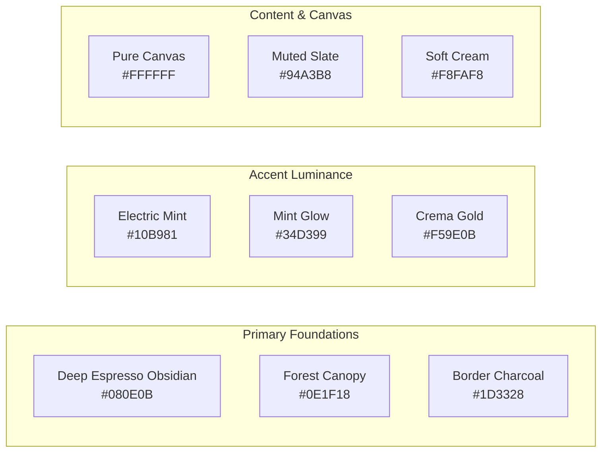

# 🎨 BrewPluse Master Design System & Visual Architecture: "Artisan Obsidian & Fresh Emerald"

**Design System Version:** 2.0.0  
**Target Property:** [BrewPluse.com](https://brewpluse.com/)  
**Date:** November 17, 2026  
**Lead Architects:** UI/UX Principal, SaaS Design Architect, Accessibility Lead (WCAG 2.2 AA)  
**Philosophy:** An original, independent design identity that balances the artisanal warmth of specialty coffee culture with the crisp precision, dark-mode elegance, and high-velocity clarity of a modern cloud operating system.

---

## 1. Brand Identity & Aesthetic Positioning

BrewPluse is built for the modern cafe operator—entrepreneurs who care deeply about craft, speed, customer experience, and autonomy.

### Aesthetic Tone & Visual Values
- **Artisanal yet Engineered:** Combines rich, organic deep-toned backgrounds (Espresso Obsidian and Deep Forest) with luminous, electric green accents (Fresh Mint / Emerald) that signify live telemetry, uptime, and velocity.
- **Dashboard-Centric SaaS:** Every section reinforces real-time operational control with crisp borders, subtle glassmorphic blurs, and live interactive UI components.
- **Zero Generic Clutter:** Replaces stock clip art and generic 3D illustrations with actual, high-fidelity UI viewports, realistic hardware line drawings, and micro-metric displays.

---

## 2. Color Palette & Token Architecture

The BrewPluse color token system guarantees high contrast ratios exceeding WCAG 2.2 AA standards (minimum 4.5:1 for body copy and 3.0:1 for large display headers).

### 2.1 Complete Token Table
| Token Name | Hex Code | Purpose & Semantic Role | WCAG Contrast on #080E0B |
|---|---|---|:---:|
| `brew-obsidian` | `#080E0B` | Primary application & dark marketing background canvas | N/A (Canvas) |
| `brew-dark` | `#0D1612` | Card backgrounds, drawer panels, modal containers | Subtle separation |
| `brew-card` | `#13201A` | Secondary elevated surface, interactive hover containers | High contrast |
| `brew-border` | `#1E362B` | Default card borders, dividers, subtle structural strokes | 3.2:1 (Decorative) |
| `brew-border-active` | `#2D5543` | Focused inputs, active tabs, highlighted cards | 4.8:1 |
| `brew-primary` | `#10B981` | Primary CTA buttons, badges, live status indicators | 6.8:1 (AAA large) |
| `brew-primary-hover` | `#059669` | Hover state for primary action buttons | 5.2:1 |
| `brew-mint-glow` | `#34D399` | Gradient text highlights, active toggle knobs | 9.4:1 |
| `brew-crema` | `#F59E0B` | Warm warning badges, secondary accent highlights | 7.9:1 |
| `brew-text-title` | `#FFFFFF` | Primary headlines, metric displays, modal titles | 18.2:1 (AAA) |
| `brew-text-body` | `#CBD5E1` | Standard prose, card descriptions, table content | 10.4:1 (AAA) |
| `brew-text-muted` | `#94A3B8` | Subtext, timestamps, breadcrumbs, helper notes | 6.1:1 (AA) |
| `brew-light-bg` | `#F8FAF8` | High-contrast light documentation canvas | 19.1:1 on #080E0B |
| `brew-light-card` | `#FFFFFF` | Light theme card background | High contrast |
| `brew-light-border` | `#E2E8F0` | Light theme dividing lines and borders | 1.3:1 (Subtle stroke) |

---

## 3. Typography System & Hierarchy

BrewPluse uses a tri-font typography stack engineered for legibility across mobile screens, kitchen tablets, and desktop terminals:

1. **Display & Headings:** `Plus Jakarta Sans` — Contemporary geometric sans-serif with high x-height, delivering authority and modern SaaS elegance.
2. **Body & Interface:** `Inter` — Precision neutral typeface optimized for readability across dense tabular data and micro-copy.
3. **Data, Receipts & Telemetry:** `JetBrains Mono` — Monospaced font for prices, order numbers, ESC/POS receipt previews, and currency calculations.

### Typography Scale Table
| Role | Font Family | Size (px/rem) | Line Height | Weight | Letter Spacing |
|---|---|:---:|:---:|:---:|:---:|
| **Hero H1** | Plus Jakarta Sans | 56px / 3.5rem | 1.1 | 800 (Extrabold) | -0.03em |
| **Section H2** | Plus Jakarta Sans | 38px / 2.375rem | 1.2 | 700 (Bold) | -0.025em |
| **Card H3** | Plus Jakarta Sans | 24px / 1.5rem | 1.3 | 600 (Semibold) | -0.015em |
| **Subsection H4** | Plus Jakarta Sans | 18px / 1.125rem | 1.4 | 600 (Semibold) | -0.01em |
| **Body Large** | Inter | 18px / 1.125rem | 1.6 | 400 (Regular) | 0 |
| **Body Regular**| Inter | 15px / 0.9375rem| 1.6 | 400 / 500 | 0 |
| **Caption / Small**| Inter | 13px / 0.8125rem| 1.5 | 400 (Regular) | +0.01em |
| **Badge / Kicker**| Inter | 11px / 0.6875rem| 1.4 | 700 (Bold) | +0.08em (Uppercase) |
| **Code / Price** | JetBrains Mono | 14px / 0.875rem | 1.5 | 600 (Semibold) | -0.01em |

---

## 4. UI Components & Interaction Standards

### 4.1 Buttons & Interactive CTAs
- **Primary CTA Button:**
  - Background: Gradient `from-emerald-500 to-emerald-600` (`#10B981` to `#059669`).
  - Text: Solid `#080E0B` (Dark Obsidian) or Pure White `#FFFFFF`, Font Semibold.
  - Radius: `rounded-xl` (12px).
  - Hover: Subtle scale `hover:scale-[1.02]`, shadow glow `shadow-lg shadow-emerald-500/20`.
  - Active: `scale-[0.98]` micro-feedback.
- **Secondary / Sandbox CTA Button:**
  - Background: Transparent with frosted backdrop (`bg-white/5 hover:bg-white/10`).
  - Border: 1px solid `border-white/15 hover:border-emerald-500/50`.
  - Text: `#FFFFFF`, Font Medium.
- **Micro-Pills / Badges:**
  - Background: `bg-emerald-500/10`, border `border-emerald-500/30`, text `text-emerald-400 font-mono text-xs uppercase tracking-wider`.

### 4.2 Card Styles & Elevation Hierarchy
- **Level 1 (Base Container):** `bg-[#0D1612] border border-[#1E362B] rounded-2xl p-6 sm:p-8`.
- **Level 2 (Featured / Highlight Card):** `bg-gradient-to-b from-[#14231C] to-[#0D1612] border border-emerald-500/30 shadow-xl shadow-emerald-950/20 rounded-3xl`.
- **Level 3 (Interactive Element Card):** Glassmorphic backdrop (`backdrop-blur-md bg-white/[0.03] border border-white/10 hover:border-emerald-500/40 transition-all duration-300`).

### 4.3 Form Inputs & Accessible Controls
- **Input Fields:**
  - Height: `h-12` (48px) for optimal touch target on mobile viewports.
  - Background: `#080E0B`, border `1px solid #1E362B`, text `#FFFFFF`, placeholder `#64748B`.
  - Focus Ring: `focus:ring-2 focus:ring-emerald-500/50 focus:border-emerald-500 outline-none`.
- **Error States:**
  - Border: `border-rose-500`, helper text: `text-xs text-rose-400 font-medium mt-1`.

---

## 5. Responsive Layouts & Breakpoint Ergonomics

BrewPluse strictly adheres to a mobile-first responsive architecture:

| Breakpoint | Pixel Width | Layout Adjustments |
|---|:---:|---|
| **Mobile Extra-Small** | `<380px` | Single column; 16px horizontal page gutters; 44px minimum tap targets; zero floating collision widgets. |
| **Mobile Standard** | `380px–639px` | Single column; hero CTAs stack vertically; navigation collapses into accessible slide-out drawer. |
| **Tablet Portrait** | `640px–767px` | 2-column feature grids; side-by-side pricing cards. |
| **Tablet Landscape** | `768px–1023px`| 2-column layout with sticky sidebar headers; full comparison tables with horizontal scroll indicators. |
| **Desktop Standard** | `1024px–1279px`| 3-column feature grids; dual-pane interactive sandbox preview; sticky top navigation. |
| **Large Desktop** | `1280px+` | Max container width `max-w-7xl` (1280px); generous 80px–112px section vertical padding. |

---

## 6. Iconography, Assets & Original Illustration Rules

1. **Icon Library:** Strictly standardized on `lucide-react` (24px default, stroke-width `1.75px` or `2.0px`) for consistent optical balance.
2. **Original Assets Policy:**
   - Zero copy-pasting of CafeFlow vector assets or screenshots.
   - All product screenshots will be programmatically rendered from BrewPluse's own live views (`src/app/demo`, `src/app/kitchen`, `src/app/m`).
   - Thermal printer and hardware diagrams must be created as clean SVG schematics with BrewPluse branding.
