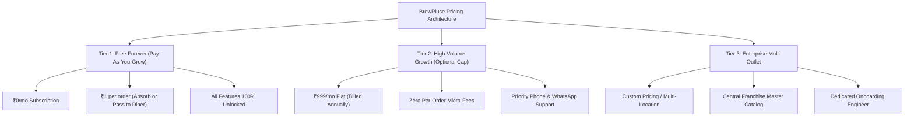

# 💰 BrewPluse Strategic Pricing & Commercial Monetization Model

**Document Version:** 1.0.0  
**Target Property:** [BrewPluse.com](https://brewpluse.com/)  
**Date:** November 17, 2026  
**Strategy Consultant:** Pricing & Product Strategy Lead, CRO Architect, Hospitality Economics Specialist  
**Approval Gate:** Strategic Proposal — No production pricing changes will be deployed without explicit administrative sign-off.

---

## 1. Competitive Pricing Landscape & Empirical Observations

To establish an unbeatable market positioning, we evaluated the three prevailing economic paradigms in restaurant and cafe software:

### 1.1 Competitor Observed Models
1. **Legacy Incumbent Model (Petpooja, Posist/Restroworks, GoFrugal):**
   - **Upfront & Annual Fees:** ₹15,000 to ₹35,000 annually per terminal.
   - **Hidden Costs:** Annual Maintenance Contracts (AMC) ₹3,000–₹6,000/yr; add-on fees for KDS (₹5,000), digital QR ordering (₹6,000), SMS integrations, and third-party aggregator sync.
   - **Hardware Lock-In:** Requires certified proprietary desktop terminals (often adding ₹25,000–₹45,000 in upfront CAPEX).
   - **Friction:** Demands advance annual commitments before a cafe can ring up its first cup of coffee.

2. **CafeFlow.fun (Disruptive Competitor):**
   - **Software Subscription:** **₹0 / month forever**.
   - **Module Gating:** 100% unlocked (POS, QR ordering, KDS, inventory, loyalty).
   - **Transaction Micro-Fee:** **₹1 per completed order** (with options for the cafe owner to either absorb the fee or pass it transparently to the customer during checkout).
   - **Hardware:** 100% BYOD (Bring Your Own Device) — works on consumer tablets, iPads, and standard ESC/POS printers.

3. **BrewPluse Existing Model:**
   - **Current Model:** ₹0 / month software subscription forever, with a nominal ₹1 per completed order.
   - **Hardware Offerings:** Direct catalog for thermal Bluetooth/USB printers and acrylic table QR stands.
   - **Current Presentation:** Static two-card display on `/pricing` and homepage.

---

## 2. Competitive Synthesis & Opportunity Analysis

While CafeFlow's flat ₹1/order model is highly disruptive for small, bootstrapped coffee shops, it introduces a natural friction point for high-volume quick-service restaurants (QSRs) and multi-outlet chains:

> **The High-Volume Dilemma:** A busy QSR or coffee shop processing 400 orders per day accumulates 12,000 orders per month = ₹12,000/month in micro-fees. At that scale, traditional annual software (₹15,000/year) becomes mathematically cheaper than an un-capped per-order fee.

### Strategic Advantage for BrewPluse:
BrewPluse can beat CafeFlow by introducing the **"Dual-Choice Transparency Engine"**:
1. **Option A (Zero-Risk Pay-As-You-Grow):** ₹0/month forever + ₹1/order (Ideal for startups, independent cafes, and seasonal coffee shops).
2. **Option B (High-Volume Fixed Cap):** For high-volume cafes, offer an optional monthly cap or fixed subscription (e.g., ₹999/month flat with 0 per-order fees), guaranteeing that BrewPluse is **always** cheaper than both Petpooja and CafeFlow at every scale!

---

## 3. Recommended BrewPluse Pricing Architecture

### 3.1 Plan Comparison & Specifications Table

| Feature / Dimension | Starter: Free Forever (Recommended) | Growth: High-Volume Cap | Enterprise Multi-Chain |
|---|:---:|:---:|:---:|
| **Monthly Software Fee** | **₹0 / Month Forever** | **₹999 / Month** (Billed ₹11,988/yr) | Custom Multi-Store Quote |
| **Per-Order Fee** | **₹1 / order** (Payer Choice: Cafe or Diner) | **₹0 / order (Unlimited free orders)** | Volume-negotiated or ₹0 |
| **Target Operator** | Independent cafes, coffee bars, bakeries (0–100 orders/day) | High-volume QSRs, busy bistros (150–500+ orders/day) | Franchise groups (3+ locations), national brands |
| **Terminal & Device Limit** | Unlimited devices (iPads, Android, Laptops) | Unlimited devices | Unlimited devices & outlets |
| **Staff Accounts & PINs** | Unlimited staff accounts | Unlimited staff accounts | Role-based RBAC with audit trails |
| **Cloud POS & Billing** | Included (Touch & Keyboard) | Included (Touch & Keyboard) | Included + Centralized reporting |
| **Contactless QR Ordering** | Included + Geofence fraud check | Included + Geofence fraud check | Included + Multi-table zone control |
| **Paperless KDS** | Included (Unlimited kitchen screens) | Included (Unlimited kitchen screens) | Included + Station multi-routing |
| **Recipe & Stock Control** | Included (Raw ingredient decrements) | Included (Raw ingredient decrements) | Central commissary inventory |
| **Customer Loyalty & Wallet** | Included (Digital punch cards & credits) | Included | Central cross-store loyalty points |
| **ESC/POS Thermal Printing** | Included (58mm / 80mm Web Bluetooth & USB) | Included | Included |
| **GST Tax Invoices & Reports** | Included (One-click Excel/CSV export) | Included | Centralized GST filing exports |
| **Customer Support** | Community + Email + WhatsApp Desk | Priority WhatsApp Desk & Phone | Dedicated Account Manager & SLA |

---

## 4. Interactive Pricing Calculator Specification

To match and exceed CafeFlow's conversion efficacy, BrewPluse's `/pricing` page must feature an **interactive dynamic ROI calculator**:

### Calculator Mechanics & Visual Controls
1. **Interactive Slider:** Daily Order Volume (Range: 10 to 1,000 orders/day).
2. **Toggle Button:** Fee Payment Mode (`Cafe Absorbs ₹1` vs. `Passed to Customer as Convenience Fee`).
3. **Live Output Metrics:**
   - **BrewPluse Software Cost:** ₹0 / month.
   - **Monthly Order Fees:** If passed to diner = **₹0 net expense for the cafe**. If absorbed = `Orders/day * 30 * ₹1`.
   - **Legacy Incumbent Cost (Petpooja/Posist):** ₹1,800/month (amortized subscription + AMC + add-on fees).
   - **Annual Net Savings Banner:** e.g., *"Your cafe saves ₹21,600 every year with BrewPluse!"*

---

## 5. Monetization Beyond Software Subscriptions

To maintain a durable, high-margin business without extracting punitive monthly fees from independent cafe operators, BrewPluse utilizes a multi-stream revenue flywheel:

1. **Hardware Store & Plug-and-Play Bundles:**
   - Pre-paired Bluetooth 58mm Thermal Printers (₹3,999).
   - High-speed 80mm Auto-Cutter USB/LAN Thermal Printers (₹6,499).
   - Laser-engraved Acrylic QR Table Stands with NFC chips (₹199/table).
2. **Payment Gateway Convenience Sharing:**
   - Optional integrated UPI payment processing via Razorpay/Cashfree with micro-convenience margin splits.
3. **White-Glove Assisted Onboarding & Menu Digitalization:**
   - While setup is 100% free for self-serve merchants, busy owners can purchase an optional ₹1,499 white-glove setup package where BrewPluse engineers digitize their physical paper menus, upload high-res photos, and configure table floor plans.
